 

  

 

&nbsp;&nbsp;<code>🌱 now</code>

 

Building **BuildHive** (slowly, intentionally). Going deep on DSA — the kind of problems that make you question your life choices at 11pm and feel like a genius at 2am. Making Python less intimidating than it initially looked. Recently got obsessed with GSAP timing functions and WebGL shaders.

 

### `01` &nbsp;·&nbsp; Selected Work

<table>
  <tr>
    <td width="50%" valign="top">
      <h3>BuildHive &nbsp;<code>studio</code></h3>
      
Premium, motion-led websites for clients who care about craft. I turn ideas into interfaces with Next.js, GSAP, and WebGL — the kind of sites people screenshot and share.

      <code>Next.js</code> &nbsp;<code>GSAP</code> &nbsp;<code>Three.js</code> &nbsp;<code>WebGL</code> &nbsp;<code>TailwindCSS</code>  
      <!-- TODO: replace # with live BuildHive URL when ready -->
      <a href="#">View studio →</a>
    </td>
    <td width="50%" valign="top">
      <h3>Sophrion &nbsp;<code>platform</code></h3>
      
An education platform built around clarity and atmosphere. Learning that doesn't feel like studying — dark-themed, well-designed, and actually usable.

      <code>React</code> &nbsp;<code>Node.js</code> &nbsp;<code>MongoDB</code> &nbsp;<code>UI systems</code>  
      <a href="https://sophrion.co.in">sophrion.co.in →</a>
    </td>
  </tr>
</table>

### `02` &nbsp;·&nbsp; Arsenal

 

### `03` &nbsp;·&nbsp; Signal

  

 

