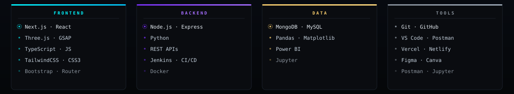

 

## ⚡ About Me 👨‍💻

👨‍💻 I'm a **Computer Science student** passionate about both **development and design**.

🤝 I'm looking to collaborate on **Python projects, web apps, and beginner-friendly open-source projects** that combine design and code.

🧠 I'm looking for help with **advanced Python concepts, Data Structures, and the fundamentals of AI/ML**.

🌱 I'm currently learning **Python** and improving my **UI/UX design skills**.

💬 Ask me about **Python basics, frontend design ideas, and beginner project planning**.

⚡ Fun fact: I love turning ideas into **visually appealing and functional applications 🚀**

## 🌐 Socials

  

 

&nbsp;&nbsp;<code>🌱 now</code>

 

Building **BuildHive** (slowly, intentionally). Going deep on DSA — the kind of problems that make you question your life choices at 11pm and feel like a genius at 2am. Making Python less intimidating than it initially looked. Recently got obsessed with GSAP timing functions and WebGL shaders.

### `01` &nbsp;·&nbsp; Selected Work

<table>
  <tr>
    <td width="50%" valign="top">
      <h3>BuildHive &nbsp;<code>studio</code></h3>
      
Premium, motion-led websites for clients who care about craft. I turn ideas into interfaces with Next.js, GSAP, and WebGL — the kind of sites people screenshot and share.

      <code>Next.js</code> &nbsp;<code>GSAP</code> &nbsp;<code>Three.js</code> &nbsp;<code>WebGL</code> &nbsp;<code>TailwindCSS</code>  
      <!-- TODO: replace # with live BuildHive URL -->
      <a href="#">View studio →</a>
    </td>
    <td width="50%" valign="top">
      <h3>Sophrion &nbsp;<code>platform</code></h3>
      
An education platform built around clarity and atmosphere. Learning that doesn't feel like studying — dark-themed, well-designed, and actually usable.

      <code>React</code> &nbsp;<code>Node.js</code> &nbsp;<code>MongoDB</code> &nbsp;<code>UI systems</code>  
      <a href="https://sophrion.co.in">sophrion.co.in →</a>
    </td>
  </tr>
</table>

### `02` &nbsp;·&nbsp; Tech Stack

 

 

**`FRONTEND`**

**`BACKEND`**

**`DATABASE`**

**`DEVOPS & TOOLS`**

**`DESIGN & DATA`**

### `03` &nbsp;·&nbsp; Signal

  

 

### 🔗 Coding Profiles

  
  &nbsp;
  
  &nbsp;
  

## ✍️ Random Dev Quote

